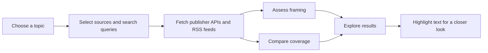

<div align="center">

# RealNews

### One story. Every perspective.

Compare how the world covers the news — from the headline to the details that make it different.


[Explore the features](#a-wider-view-of-the-story) · [Run locally](#run-locally) · [API](#api-at-a-glance) · [Development](#development)

</div>

---

## A wider view of the story

RealNews brings reporting from multiple publishers into one place. Browse current stories, switch between sources, or investigate a topic with AI-assisted comparisons of wording, framing, and coverage.

| Feature | What you can do |
| --- | --- |
| **The news desk** | Browse headlines grouped by event and filter for stories with multiple perspectives. |
| **Topic analysis** | Enter a topic and watch source selection, article collection, and analysis progress live. |
| **Source comparison** | Explore source-level bias assessments, shared facts, a neutral summary, and missing context. |
| **Coverage differences** | Compare specific details across excerpts, with supporting quotes where available. |
| **Highlight analysis** | Select article text to inspect its framing, see a neutral rewrite, and find relevant wording from other sources. |
| **Global context** | View source locations on an interactive map. |
| **Recent analyses** | Reopen the eight most recent results saved in your browser. |

## How it works



The Express backend uses Groq's `openai/gpt-oss-20b` model for source selection, analysis, and feed grouping. Topic analysis selects five RSS sources from the configured publisher list, then also queries The Guardian and The New York Times. Progress and results stream to the client through server-sent events.

The home feed combines The New York Times, The Guardian, BBC, Al Jazeera, Deutsche Welle, and France 24. It caches results in memory for five minutes, tolerates individual publisher failures, and can serve saved coverage when fresh headlines are unavailable.

> Analysis is based on the available excerpts. A detail missing from an excerpt is not proof that a publisher omitted it, and AI-generated assessments should be checked against the original reporting.

## Run locally

### 1. Install dependencies

Use **Node.js 22.12+** (or a newer supported LTS release) and npm. From the repository root:

```bash
cd server
npm ci
cd ../client
npm ci
```

### 2. Configure the backend

Create `server/.env` with your own provider credentials:

```dotenv
GROQ_API_KEY=your_groq_api_key
NYT_API_KEY=your_new_york_times_api_key
GUARDIAN_API_KEY=your_guardian_api_key
```

| Variable | Used for | Get access |
| --- | --- | --- |
| `GROQ_API_KEY` | AI analysis and headline grouping | [Groq Console](https://console.groq.com/) |
| `NYT_API_KEY` | Top Stories and Article Search APIs | [NYT Developer Portal](https://developer.nytimes.com/) |
| `GUARDIAN_API_KEY` | Guardian article search | [Guardian Open Platform](https://open-platform.theguardian.com/access/) |

Enable both **Top Stories** and **Article Search** for your NYT application. Keep credentials on the server; `.env` files are ignored by Git. Live use makes external API requests and may consume provider quotas or incur charges. Claude is not required by the current application.

### 3. Start both services

In one terminal:

```bash
cd server
npm run dev
```

In another terminal:

```bash
cd client
npm run dev
```

Open [localhost:5173](http://localhost:5173). The backend listens on [localhost:3001](http://localhost:3001); Vite proxies `/api/*` to it and strips the `/api` prefix.

Check the backend independently:

```bash
curl http://localhost:3001/health
# {"status":"ok"}
```

## Project map

```text
RealNews/
├── client/                  React application, served by Vite
│   ├── src/
│   │   ├── pages/           News desk and analysis results
│   │   ├── components/      Story cards, coverage, map, and selection popup
│   │   └── hooks/           Highlight requests, caching, and cancellation
│   ├── tests/               Unit and Playwright browser checks
│   └── vite.config.js       React, Tailwind CSS, and API proxy
├── server/
│   ├── agents/              Source selection, judgment, and comparisons
│   ├── fetchers/            RSS, Guardian, and NYT integrations
│   ├── services/            Cached headline feed and event grouping
│   ├── *.integration.test.js
│   └── index.js             Express routes and streaming analysis
└── README.md
```

The UI uses React Router, Tailwind CSS, and Leaflet. Recent results live in browser `localStorage`; the server's feed cache lives in process memory. There is no database setup step.

## API at a glance

These paths are relative to the backend. Use `/api` before each path when calling through the Vite proxy.

| Method | Route | Purpose |
| --- | --- | --- |
| `GET` | `/health` | Basic server health check. |
| `GET` | `/stories` | Grouped news feed with freshness and publisher availability metadata. |
| `GET` | `/top-stories?section=home` | NYT top stories for a section. |
| `POST` | `/analyze` | Stream progress and comparison results for `{"topic":"AI Regulation"}`. |
| `POST` | `/highlight` | Analyze a selection using `selectedText`, `sourceName`, `selectedArticleId`, and `allArticles`. |

Example streamed analysis:

```bash
curl -N http://localhost:3001/analyze \
  -H 'Content-Type: application/json' \
  -d '{"topic":"AI Regulation"}'
```

`/analyze` sends `data:` events with agent progress, followed by a `type: "result"` event containing the articles, verdict, coverage comparisons, and source locations. `selectedArticleId` in highlight requests is the zero-based index of the selected article in `allArticles`.

## Development

Run the backend's unit and integration checks from `server/`:

```bash
node --test agents/*.test.js services/*.test.js *.integration.test.js
```

Run frontend checks from `client/`:

```bash
npm test
npm run lint
npm run build
```

For browser checks, start the Vite dev server first, then run from `client/`:

```bash
npx playwright install chromium
npm run test:browser
npm run test:home
npm run test:responsive
```

Browser tests default to `http://127.0.0.1:5173`. Set `HIGHLIGHT_TEST_URL` to use another address, or `PLAYWRIGHT_CHROMIUM_EXECUTABLE_PATH` to use an existing Chromium installation. The default browser checks use mocked API responses; the home test can additionally exercise live news providers with `HIGHLIGHT_LIVE_TEST=1` when the backend and credentials are available.

`npm run build` creates `client/dist`. Production hosting must serve that output, handle client-side routes, and route API traffic to Express; the Vite development proxy is not a production reverse proxy.

---

<div align="center">

**Make room for another perspective.**

Headlines and excerpts belong to their respective publishers. Follow the original links for the full reporting.

</div>
